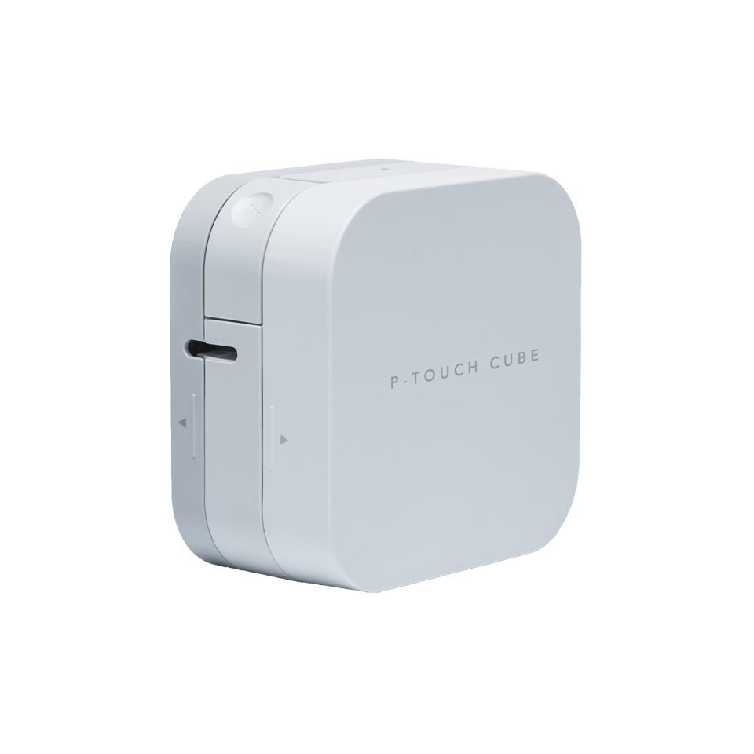
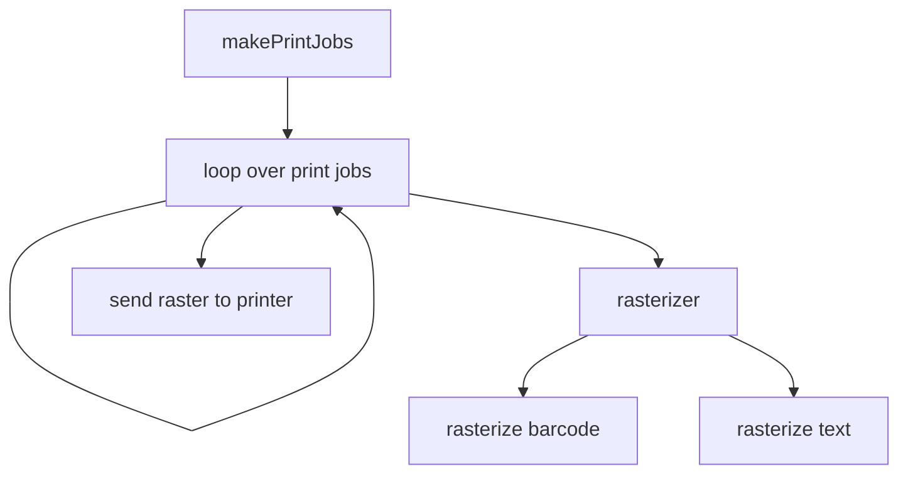

⬆️ For table of contents, click the above icon

Print text and barcodes from command line to Brother P-Touch printers.

WARNING
-------

Currently it's shit code.


Tested hardware
---------------

Brother P-Touch Cube PT-P300BT



Other models may work, but are not guaranteed to do so.

12 mm tape

Quickstart
----------

Overall flow:

1. Download this software from GitHub releases page
1. Make printer available as a serial port (has to be done only once)
	* Run `$ sudo bluetoothctl`
		* Type `scan on`
		* Find device with name beginning with `PT-P...` (the name is the Brother printer model name)
		* Type `pair <bluetooth address>` (where the address is something like `EC:79:49:...`)
	* Then `$ sudo rfcomm bind 0 <bluetooth address>`
		* This should make `/dev/rfcomm0` appear
1. Print to it
	* `$ ./printers datamatrix helloworld hello.png`
	* `$ ./printers print hello.png`

Web UI deployment
-----------------

Build and run the container with access to the receipt printer and label printer:

```sh
docker build -t print-ui .
docker run --rm -p 80:80 \
  --device /dev/usb/lp0 \
  --device /dev/rfcomm0 \
  print-ui
```

The web UI serves receipt printing at `/printers`, PDF printing at `/printers/pdf`, label printing at `/printers/labels`, and code generation at `/printers/codes`. PDF printing uses the IPPS endpoint `ipps://brotherlaser.home.fn61.net:443/printers/brotherlaser` by default. The container must be able to reach the endpoint and trust its TLS certificate. CA certificates are included in the image; a private CA must also be made available to the container's trust store.

To use another IPPS printer, override the server command:

```sh
docker run --rm -p 80:80 \
  --device /dev/usb/lp0 \
  --device /dev/rfcomm0 \
  print-ui server --listen=:80 --ipp-printer-uri=ipps://printer.example.com/printers/queue
```

No Docker socket or sibling CUPS container is required for PDF printing.


Architecture
------------




Thanks
------

- https://github.com/robby-cornelissen/pt-p710bt-label-maker
	* Got me started on reverse-engineering this and serves as the base for the initial port
